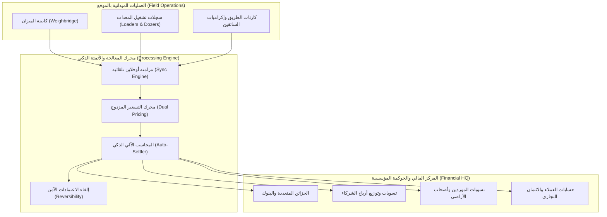
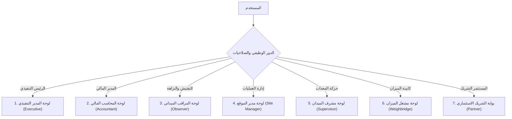
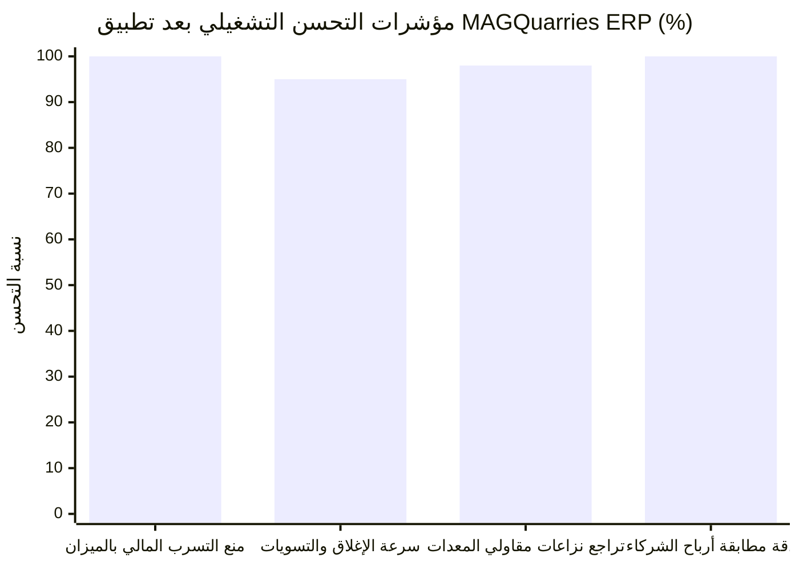

# 🏔️ MAGQuarries ERP | نظام ماج المتكامل لإدارة المحاجر والتعدين والمعدات الثقيلة

> **The Intelligent Enterprise Operating System for Quarries, Mining Operations, Crushing Plants & Heavy Earthmoving Fleets.**  
> **منظومة التخطيط المؤسسي الأكثر شمولاً واعتمادية لإدارة مواقع التعدين، الموازين، عقود المعدات الثقيلة، وحوكمة استثمارات الشركاء.**

---

---

## 📑 فهرس المحتويات الشامل

1. [الملخص التنفيذي ورؤية المنظومة (Executive Summary)](#1-الملخص-التنفيذي-ورؤية-المنظومة)
2. [تحديات قطاع المحاجر التي تعالجها المنظومة (Industry Pain Points)](#2-تحديات-قطاع-المحاجر-التي-تعالجها-المنظومة)
3. [الفلسفة المعمارية والتشغيلية للنظام (Core Architectural Philosophy)](#3-الفلسفة-المعمارية-والتشغيلية-للنظام)
4. [الموديلات والوظائف التشغيلية والمالية الشاملة (Comprehensive System Modules)](#4-الموديلات-والوظائف-التشغيلية-والمالية-الشاملة)
   - [4.1 إدارة الميزان، الشاحنات، وبونات النقل (Weighbridge & Dispatching)](#41-إدارة-الميزان-الشاحنات-وبونات-النقل)
   - [4.2 محرك التسعير المزدوج وحماية هوامش الربح (Dual-Pricing Engine)](#42-محرك-التسعير-المزدوج-وحماية-هوامش-الربح)
   - [4.3 أسطول المعدات الثقيلة ونظام الاحتساب المزدوج (Heavy Equipment & Dual-Rate Engine)](#43-أسطول-المعدات-الثقيلة-ونظام-الاحتساب-المزدوج)
   - [4.4 تسويات الموردين ومطابقة الرفع المساحي الشبكي (Grid Reconciliation & Land Royalties)](#44-تسويات-الموردين-ومطابقة-الرفع-المساحي-الشبكي)
   - [4.5 حوكمة الشركاء والعزل الصارم للبيانات (Multi-Partner Governance & Isolation)](#45-حوكمة-الشركاء-والعزل-الصارم-للبيانات)
   - [4.6 المحاسب الآلي والتسويات الدورية الذكية (Autonomous Settlement Engine)](#46-المحاسب-الآلي-والتسويات-الدورية-الذكية)
   - [4.7 الحسابات المالية المتقدمة للعملاء والخصومات التجارية (Customer Financials & Discounts)](#47-الحسابات-المالية-المتقدمة-للعملاء-والخصومات-التجارية)
   - [4.8 مصاريف الطريق، الكارتات، وإكراميات السائقين (Transportation Logistics & Tips)](#48-مصاريف-الطريق-الكارتات-وإكراميات-السائقين)
   - [4.9 إدارة الخزائن المتعددة، البنوك، وشجرة الحسابات (Treasury, Banking & General Ledger)](#49-إدارة-الخزائن-المتعددة-البنوك-وشجرة-الحسابات)
   - [4.10 رأس المال البشري ومخيمات المحاجر الصحراوية (Human Capital & Camp Management)](#410-رأس-المال-البشري-ومخيمات-المحاجر-الصحراوية)
   - [4.11 لوحات التحكم السبعة الذكية بحسب الأدوار (7 Role-Based Command Dashboards)](#411-لوحات-التحكم-السبعة-الذكية-بحسب-الأدوار)
   - [4.12 موثوقية العمل دون اتصال بالإنترنت (Offline-First Resilience)](#412-موثوقية-العمل-دون-اتصال-بالإنترنت)
   - [4.13 الأمان والرقابة وإلغاء الاعتمادات الآمن (Financial Reversibility & Audit Governance)](#413-الأمان-والرقابة-وإلغاء-الاعتمادات-الآمن)
5. [العائد الاستثماري الملموس بالأرقام (Measurable Business ROI)](#5-العائد-الاستثماري-الملموس-بالأرقام)
6. [دراسة حالة واقعية: التحول الرقمي لمجمع محاجر (Real-World Case Study)](#6-دراسة-حالة-واقعية-التحول-الرقمي-لمجمع-محاجر)
7. [خيارات النشر والجاهزية المؤسسية (Deployment & System Readiness)](#7-خيارات-النشر-والجاهزية-المؤسسية)
8. [فريق التطوير وحقوق الملكية والتواصل التجاري (Author & Commercial Inquiries)](#8-فريق-التطوير-وحقوق-الملكية-والتواصل-التجاري)

---

## 1. الملخص التنفيذي ورؤية المنظومة

يمثل قطاع التعدين واستخراج الخامات والمحاجر أحد أعقد القطاعات الصناعية من حيث الرقابة التشغيلية والمالية. تتسم مواقع العمل بظروف بيئية قاسية، وتباعد جغرافي في مناطق صحراوية أو جبلية نائية تفتقر غالباً لتغطية اتصالات مستقرة، وتتداخل فيها حقوق متعددة الأطراف (ملاك أراضي، شركاء استثماريين، مقاولي معدات ثقيلة، سائقي نقل، وعملاء تجاريين).

في ظل هذه البيئة، تفشل البرامج المحاسبية التقليدية (مثل SAP و Odoo و QuickBooks) لأنها صُممت للمصانع والمكاتب المغلقة وتفترض استقرار الاتصال بالإنترنت وتبسيط دورة المبيعات. بينما في المحاجر، تُحسم الأرباح والخسائر عند كابينة الميزان، وعلى ذراع اللودر والبلدوزر، وفي دقة احتساب إتاوة الأرض وعجز الكميات الشبكية.

**نظام MAGQuarries ERP** هو نتاج خبرة ميدانية وهندسية عميقة لصياغة منظومة رقمية شاملة تجمع بين:
- **الصلابة الميدانية:** العمل المتواصل لكبائن الميزان دون إنترنت (Offline-First) وبسرعة تسجيل قياسية لا تتعدى ثوانٍ معدودة لكل شاحنة.
- **الذكاء المالي:** فك تشابك التكاليف من خلال محركات التسعير المزدوج، واحتساب المعدات المركب (المتر والساعة معاً)، والخصم التلقائي للعهد بنظام FIFO.
- **الحوكمة والنزاهة المطلقة:** عزل مالي صارم لبيانات الشركاء، وأتمتة كاملة لإغلاقات الفترات المحاسبية والتسويات دون أي تدخل يدوي قابل للتلاعب.

---

## 2. تحديات قطاع المحاجر التي تعالجها المنظومة

صُممت المنظومة لحل 6 ثغرات استنزاف مالي وتشغيلي يعاني منها ملاك ومشغلو المحاجر يومياً:

| الثغرة في الإدارة التقليدية | الأثر المالي والتشغيلي المترتب | كيف يعالجها نظام MAGQuarries ERP؟ |
| :--- | :--- | :--- |
| **التلاعب بأوزان الميزان (Weighbridge Fraud)** | حمولات غير مسجلة، تلاعب بوزن الفارغ، والتواطؤ بين السائقين ووزاني المحطة. | تسجيل الوزن الصافي المعتمد، رصد الفروق المشبوهة، منع التعديل اليدوي للأوزان، وإصدار بونات مشفرة ببصمة رقمية. |
| **تآكل هوامش الربح وعدم وضوح التكلفة** | بيع خامات بأسعار متغيرة دون معرفة التكلفة اللحظية لإتاوة المورد وصاحب الأرض. | **محرك التسعير المزدوج (Dual-Pricing):** فصل كامل بين سعر التكلفة/المحجر وسعر العميل، واحتساب هامش الربح لكل شاحنة فوراً. |
| **نزاعات مقاولي المعدات الثقيلة** | خلافات مستمرة حول ساعات التشغيل، كميات التكعيب، وضياع السلف والعهد التشغيلية. | **محرك الاحتساب المزدوج للمعدات:** احتساب المتر والساعة معاً بصيغة مركبة، وخصم السلف والعهد التشغيلية آلياً بأولوية FIFO. |
| **عجز الرفع المساحي وإتاوات الأرض** | خلافات بين الكميات المقاسة بالرفع المساحي (الشبكية) وبين ما تم نقله فعلياً على الميزان. | **نظام تسويات المحاجر الذكي:** مطابقة الرفع الشبكي مع الميزان واحتساب غرامات النقص والحد الأدنى للإنتاج آلياً. |
| **فقدان الثقة بين الشركاء والمستثمرين** | لغط شهري حول صافي الأرباح، تشابك المصروفات بين المحاجر، وصعوبة تقسيم العوائد. | **العزل الصارم للشركاء (Strict Isolation):** حسابات مستقلة لكل محجر، وتوزيع مؤتمت لصافي الربح بنسب المساهمة الدقيقة. |
| **انقطاع شبكات الاتصال بالصحراء** | تعطل خروج الشاحنات وتكدس الطرق أو اللجوء للدفاتر الورقية التي تفتح باب الفساد. | **معمارية العمل دون اتصال (Offline-First):** تسجيل النقلات محلياً، ومزامنتها لحظياً وبشكل تلقائي بمجرد توفر الاتصال. |

---

## 3. الفلسفة المعمارية والتشغيلية للنظام

تقوم المنظومة على ركائز بنيوية تضمن الاستدامة والاستقرار الإداري للمنشأة:

### 🔹 1. مركزية المحجر والعزل الصارم (Quarry-Centric Strict Isolation)
في المحاجر متعددة المواقع، لا يجوز خلط التدفقات النقدية. في نظام **MAGQuarries**، يُعد المحجر وحدة اقتصادية مستقلة ومقفلة بذاتها (Self-Contained Economic Entity). كل بون شحنة، وساعة لودر، ولتر سولار، وإيصال قبض يرتبط مباشرة بالمحجر المعني. هذا العزل يضمن للمستثمر الذي يمتلك حصة في المحجر (أ) ألا يرى مطلقاً بيانات أو أرباح المحجر (ب)، مما يوفر درعاً قانونياً ومالياً محكماً يمنع أي تضارب للمصالح.

### 🔹 2. دورة التكلفة المغلقة سداسية الأبعاد (The 6-Pillar Cost Model)
لا يكتفي النظام بجدول المصروفات النثرية كباقي البرامج المحاسبية، بل يقوم بحساب صافي تكلفة الطن أو المتر عبر تجميع 6 بنود أساسية بصورة تراكمية آلية:
1. **تكلفة الخام للموردين:** سعر الخام المستخرج من الجبل.
2. **إتاوة الطريق والتصاريح:** الرسوم الحكومية ورسوم المرور ومقالع الطرق.
3. **عجارة الأرض (Land Royalties):** استحقاقات مالك الأرض أو الهيئة المانحة للترخيص.
4. **تسويات المعدات الثقيلة:** الأجر المستحق للمقاولين عن ساعات العمل والتكعيب بعد استقطاع العهد.
5. **رواتب وبدلات عمالة المحجر:** احتساب استحقاقات المهندسين والعمال والإعاشة الميدانية.
6. **المصروفات التشغيلية والميدانية:** المصروفات الإدارية والميدانية ونثريات الموقع.

---

## 4. الموديلات والوظائف التشغيلية والمالية الشاملة

### 4.1 إدارة الميزان، الشاحنات، وبونات النقل (Weighbridge & Dispatching)
تعتبر كابينة الميزان شريان الإيراد الرئيسي في أي محجر. صُمم هذا الموديول ليعمل تحت أقسى درجات الضغط الميداني:
- **حساب الأوزان التلقائي ثلاثي المراحل:** (الوزن القائم Gross - وزن الفارغ Tare = الوزن الصافي Net) مع الربط الفوري بنوع الخامة التعدينية (سن 1، سن 2، دبش، بازلت، رمل، دولوميت، بودرة، كتل رخام/جرانيت).
- **التحقق الديناميكي من الفارغ (Anti-Fraud Tare Checking):** تخزين سجل تاريخي لوزن فارغ كل شاحنة لمنع التلاعب بتفريغ خزانات المياه أو تغيير حمولة الشاحنة قبل الوزن لسرقة الخام.
- **طباعة بونات الخروج الذكية (Instant Thermal Ticket):** إصدار بون شحن فوري متضمن رقم النقلة، اسم العميل، اسم السائق، رقم اللوحة، الوزن الإجمالي، ونوع الخامة، مع باركود أو QR Code لمنع تزوير البونات عند بوابات التفتيش.
- **التحقق من الرصيد الائتماني للعميل:** لا يسمح الميزان بخروج الشاحنة للعملاء الآجلين إذا تجاوزت المديونية سقف الائتمان المتفق عليه، إلا بتصريح رقمي مباشر من الإدارة المالية.

---

### 4.2 محرك التسعير المزدوج وحماية هوامش الربح (Dual-Pricing Engine)
يمثل هذا المحرك ابتكاراً استثنائياً ينفرد به نظام **MAGQuarries** لمعالجة تسعير الخامات في قطاع التعدين:
- **فصل سعر التكلفة عن سعر البيع:** يحتفظ النظام لكل خامة بسعرين منفصلين:
  - **سعر المحجر والتكلفة المباشرة (Extraction / Supplier Cost):** ويشمل استحقاق المورد وإتاوة الأرض.
  - **سعر العميل التجاري (Customer Selling Price):** ويشمل سعر البيع النهائي شاملاً التوصيل أو على أرض الميزان.
- **الاحتساب اللحظي للربحية الصافية:** بمجرد إصدار بون النقلة، يسجل النظام فوراً الإيراد في حساب العميل، والالتزام في حساب المورد، ويثبت هامش الربح الصافي في حسابات أرباح المحجر، دون الحاجة للانتظار حتى نهاية الشهر لمعرفة نتيجة الأعمال.
- **قوائم الأسعار المرنة المخصصة:** إمكانية ربط كل عميل بقائمة أسعار تفضيلية حسب حجم المسحوبات، مع تثبيت أسعار عقود التوريد الكبرى للمشاريع القومية.

---

### 4.3 أسطول المعدات الثقيلة ونظام الاحتساب المزدوج (Heavy Equipment & Dual-Rate Engine)
تستهلك المعدات الثقيلة (اللوادر، الحفارات، البلدوزرات، الكسارات المتنقلة) الجزء الأكبر من التدفقات النقدية. يقدم النظام حلاً هندسياً شاملاً لعقود تشغيل المعدات:

#### 🚜 نظام احتساب المعدات المزدوج (المتر والساعة معاً - Dual-Rate Hybrid Engine)
في عقود المحاجر المتطورة، يتم التعاقد مع مقاولي اللوادر والبلدوزرات بصيغة مركبة تضمن أقصى إنتاجية:
$$\text{إجمالي تكلفة التشغيل} = (\text{عدد الأمتار المكعبة المستخرجة} \times \text{سعر المتر}) + (\text{ساعات العمل الفعلية} \times \text{سعر الساعة})$$
- يتيح النظام تفعيل هذا الخيار في كارت المعدة، ليقوم تلقائياً بتطبيق المعادلة في السجلات اليومية الميدانية.
- **حماية سرية الأسعار:** واجهة تسجيل يوميات المعدة الميدانية مصممة لعزل مدخل البيانات الميداني والمشرف تماماً عن رؤية أسعار الساعة أو المتر؛ يسجل المشرف فقط قراءة العداد والأمتار، بينما يقوم النظام المالي الداخلي باحتساب القيم تلقائياً خلف الكواليس.

#### 🔄 إدارة السلف وخصم عهد المعدات بنظام FIFO
- تصرف للمعدات والمقاولين مبالغ نقدية وسلف تشغيلية دورية لمواجهة التزاماتهم الميدانية.
- يسجل النظام هذه المبالغ كـ **عهد وسلف تشغيلية (Equipment Advances)** مرتبطة بالمعدة والمقاول بشكل مستقل.
- عند إصدار التسوية المالية الدورية للمعدة، يقوم النظام تلقائياً باستقطاع السلف القائمة باستخدام خوارزمية **الأقدم فالأحدث (FIFO - First-In, First-Out)**، مع ربط إيصالات الخصم برقم التسوية لضمان عدم تكرار الخصم أو إسقاط أي سلفة تاريخية.

---

### 4.4 تسويات الموردين ومطابقة الرفع المساحي الشبكي (Grid Reconciliation & Land Royalties)
أحد أكبر أسباب النزاعات القضائية في قطاع المحاجر هو الاختلاف بين دفاتر الميزان والمسح الطبوغرافي:
- **مطابقة كميات الشبكية (Surveyor Grid Reconciliation):** يتيح النظام استيراد كميات الرفع المساحي الدورية لمكعبات الجبل المقطوعة، ومقارنتها آلياً بإجمالي الحمولات التي مرت عبر الميزان.
- **احتساب غرامات العجز وعجارة الأرض:** إذا كشف الرفع المساحي عن استخراج كميات تفوق ما سُجل على الميزان (تهريب خامات)، أو إذا عجزت مبيعات الموقع عن تحقيق الحد الأدنى للإنتاج المشترط في عقد الأرض، يقوم النظام بحساب الفارق وتوليد استحقاقات مالية فورية على المقاول أو تسوية حساب صاحب الأرض آلياً وفق الشروط التعاقدية.

---

### 4.5 حوكمة الشركاء والعزل الصارم للبيانات (Multi-Partner Governance & Isolation)
صُمم هذا المحور ليكون الضمانة الاستثمارية الأولى لأصحاب رؤوس الأموال:
- **عزل أمني تام للمستثمرين (Strict Partner Security Wall):** تضمن المنظومة حجب البيانات المالية والإحصائية لأي محجر لا يمتلك فيه الشريك حصة رسمية. لن يتمكن الشريك من رؤية عملاء المحاجر الأخرى، أو معداتها، أو مسحوباتها النقدية.
- **التوزيع التلقائي للأرباح الصافية:** يحتسب النظام صافي ربح المحجر الفعلي:
$$\text{صافي الربح القابل للتوزيع} = \text{إجمالي الإيرادات} - (\text{تكلفة الخام} + \text{إتاوة الأرض} + \text{تكاليف المعدات} + \text{المصروفات الميدانية} + \text{الرواتب})$$
ويقوم النظام فوراً بتقسيم هذا الربح وإيداعه دفترياً في حسابات الشركاء وفق نسب الملكية المقيدة في عقد التأسيس.
- **إدارة المسحوبات الشخصية وتغذية رأس المال:** متابعة مسحوبات الشركاء النقدية والعينية، وحساب الأرصدة الافتتاحية والمتحركة، مع إصدار كشف حساب استثماري دوري لكل شريك يوضح حركة رأس ماله وأرباحه ومسحوباته بمنتهى الشفافية.

---

### 4.6 المحاسب الآلي والتسويات الدورية الذكية (Autonomous Settlement Engine)
تستبدل المنظومة العمليات اليدوية المرهقة بمحرك أتمتة محاسبي متكامل:
- **إغلاقات الفترات بنقرة زر واحدة:** في المواعيد المحددة (نهاية الشهر أو الأسبوع)، يقوم المحاسب الآلي بتجميع كافة النقلات، سجلات المعدات، عهد السولار، ومصاريف النقل، وتوليد كشوف التسويات الكاملة لكل من:
  1. مقاولي المعدات الثقيلة (موضحاً به ساعات التشغيل، الأمتار، السلف المستقطعة، والصافي المستحق).
  2. موردي الخامات وأصحاب الأراضي (موضحاً به الكميات المستخرجة، الإتاوة، ومطابقات الشبكية).
  3. الشركاء والمستثمرين (موضحاً به نصيب كل شريك وصافي أرباح الفترة).
- **إصدار مستندات الاعتماد الرسمية:** توليد إيصالات وكشوف تسوية احترافية جاهزة للطباعة والاعتماد البنكي والتوقيع الميداني.

---

### 4.7 الحسابات المالية المتقدمة للعملاء والخصومات التجارية (Customer Financials & Discounts)
نظراً لكبر حجم المعاملات مع كبرى شركات المقاولات ومصانع الخرسانة والأسفلت، يوفر النظام بيئة مالية محكمة:
- **إدارة الأرصدة الدائنة ومقدمات الدفع (Credit Balances):** استيعاب دفعات العملاء المقدمة وحجز قيمتها آلياً للنقلات اليومية.
- **الرد التلقائي للدفعات عند رفض النقلة (Auto-Refund on Weighbridge Rejection):** في حال رفض الشحنة عند الميزان أو إعادة تفريغها بسبب مخالفة المواصفات، يقوم النظام فوراً بفك الحجز المالي وإعادة القيمة لرصيد العميل دون ترك أي مبالغ معلقة.
- **أداة المزامنة وإعادة التوزيع المالي (Heal Customer Financials):** أداة متطورة تصحح أي انحرافات تاريخية في أرصدة العملاء الناتجة عن إدخالات يدوية سابقة، وتطابق رصيد حساب الأستاذ العام مع إجمالي فواتير النقلات الفعلية بدقة 100%.
- **محرك الخصومات التجارية ومبدأ الاستحقاق:** إدارة الخصومات الكمية والتجارية للعملاء الكبار، مع تحميل أثر الخصم على الفترة المحاسبية الصحيحة وتوزيعه عادلاً بين الشركاء دون التأثير على حسابات الموردين أو مقاولي المعدات.

---

### 4.8 مصاريف الطريق، الكارتات، وإكراميات السائقين (Transportation Logistics & Tips)
تشغيل النقل الثقيل يرتبط بتدفقات نقدية لحظية في الطرق السريعة:
- **إدارة عهد النقل والمصروفات الميدانية:** تسجيل مبالغ كارتات الموازين الطرقية، رسوم العبور (الرسوم الوطنية للمحاجر)، وإكراميات تحميل السائقين.
- **الربط المباشر بالشاحنة والنقلة:** ربط مصروف الكارتة برقم البون ورقم الشاحنة لمنع تكرار صرف المصروف، مع إثباته كبند تكلفة يخصم من ربحية النقلة أو يحمل على حساب العميل وفق طبيعة التعاقد.

---

### 4.9 إدارة الخزائن المتعددة، البنوك، وشجرة الحسابات (Treasury, Banking & General Ledger)
- **معمارية الخزائن الموزعة (Multi-Vault Architecture):** دعم تشغيل خزائن كبائن الموازين المستقلة في المواقع، خزينة الإدارة العامة المركزية، وحسابات البنوك المتعددة.
- **التحويلات النقدية والاعتماد المزدوج:** نظام تحويل آمن بين الخزائن الميدانية والخزينة المركزية، لا يعتمد دخول الأموال في الخزينة المستلمة إلا بعد تأكيد الاستلام الفعلي من أمين الصندوق المستلم لمنع ضياع النقدية أثناء النقل البري.
- **شجرة حسابات موحدة ومتوافقة مع المعايير:** شجرة حسابات متوافقة مع القيد المزدوج المحاسبي، تدعم توليد موازين المراجعة، كشوف التدفقات النقدية، وقوائم المركز المالي اللحظية.

---

### 4.10 رأس المال البشري ومخيمات المحاجر الصحراوية (Human Capital & Camp Management)
- **إدارة الورديات والمناوبات الميدانية:** نظام مرن لجدولة نوبات عمل الفنيين، سائقي اللوادر، والوزانين في المواقع الصحراوية (نظام 21 يوم عمل / 7 أيام إجازة).
- **السلف الدورية للموظفين والعمال:** تسجيل استقطاعات وسلف العاملين النقدية وإعاشة الموقع، وخصمها التلقائي من مسيرات الرواتب الشهرية.
- **مسيرات الأجور والرواتب:** استخراج كشوف أجور متكاملة تتضمن الحوافز الإنتاجية المرتبطة بمعدلات خروج الشاحنات وساعات تشغيل المعدات.

---

### 4.11 لوحات التحكم السبعة الذكية بحسب الأدوار (7 Role-Based Command Dashboards)
حرصاً على تقديم التجربة الأمثل لكل فرد في المؤسسة، يوفر النظام 7 واجهات مخصصة تماماً:

1. **لوحة المدير التنفيذي (Executive Dashboard):** رؤية بانورامية عليا لمؤشرات الأداء الرئيسية (KPIs)، صافي الأرباح المجمعة، حجم السيولة النقدية في الخزائن، إجمالي الإنتاج اليومي والشهري لكافة المحاجر، ومعدلات نمو الإيرادات.
2. **لوحة المحاسب المالي (Accountant Dashboard):** متابعة القيود اليومية، سندات الصرف والقبض، تدقيق بونات الميزان المعلقة، إعداد التسويات، ومراقبة أرصدة البنوك والعملاء والموردين.
3. **لوحة المراقب المالي والميداني (Observer Dashboard):** لوحة تفتيشية عالية الدقة لرصد أي عمليات شاذة (مثل فروق الأوزان المشبوهة، الحركات التي تمت في ساعات متأخرة، أو محاولات تعديل الحسابات).
4. **لوحة مدير الموقع (Site Manager Dashboard):** متابعة مستويات الإنجاز الميداني، معدل خروج الشاحنات لكل ساعة، أرصدة مخزون الخامات المكسرة والمستخرجة، وإدارة حركة العمليات التشغيلية.
5. **لوحة مشرف الميدان والمعدات (Supervisor Dashboard):** تسجيل ساعات تشغيل اللوادر والبلدوزرات، قراءات عدادات الساعات والأمتار، ومتابعة سجلات التشغيل اليومية واعتمادها.
6. **لوحة مشغل الميزان ومدخل البيانات (Weighbridge Dashboard):** واجهة فائقة السرعة تتيح إنهاء وزن الشاحنة وإصدار البون في أقل من 5 ثوانٍ، مع دعم كامل للتشغيل السريع عبر اختصارات لوحة المفاتيح والعمل دون إنترنت.
7. **بوابة الشريك الاستثماري (Partner Portal):** واجهة حصرية يرى الشريك من خلالها حصته فقط: أرباحه المستحقة، كشف حساب مسحوباته، ومعدلات إنتاج المحاجر المشارك فيها، مع إخفاء تام لأي أسرار تخص باقي المستثمرين.

---

### 4.12 موثوقية العمل دون اتصال بالإنترنت (Offline-First Resilience)
- **استمرارية الأعمال بنسبة 100%:** في حال انقطاع كابلات الفايبر أو تغطية شبكات المحمول في المناطق الجبلية، تستمر كابينة الميزان في العمل بشكل طبيعي وتصدر بونات الشحن دون توقف.
- **محرك المزامنة الخلفية الذكي (Automated Sync Processor):** بمجرد عودة الاتصال ولو للحظات، يقوم المحرك بمزامنة الحركات الجديدة مع السيرفر السحابي أو السيرفر المركزي، وتوليد القيود المحاسبية التلقائية وتحديث أرصدة الخزائن دون أي تدخل من المستخدم، مع خوارزميات متطورة لمنع تكرار القيود أو تعارض البيانات.

---

### 4.13 الأمان والرقابة وإلغاء الاعتمادات الآمن (Financial Reversibility & Audit Governance)
تحدث في العمليات الميدانية أخطاء بشرية كإدخال شاحنة بحساب عميل خاطئ أو تسجيل وزن مغلوط. في الأنظمة الصلبة القديمة، يتطلب تصحيح ذلك إجراءات يدوية معقدة تشوه الدفاتر:
- **محرك إلغاء الاعتماد الذكي (Intelligent Financial Unapproval):** يتيح للمدير المالي أو المدير التنفيذي فك اعتماد أي نقلة أو مصروف معتمد بضغطة زر واحدة.
- **التراجع التلقائي عن الآثار المالية المترتبة:** يقوم النظام آلياً بما يلي:
  - عكس القيود المحاسبية المسجلة تلقائياً.
  - رد المبلغ المسحوب أو المحجوز إلى خزينة الموقع أو رصيد العميل.
  - فك حجز السلف المرتبطة بنظام FIFO.
  - إعادة السجل إلى حالة "مسودة" للتعديل أو الحذف النظامي النظيف دون ترك "حركات شبحية" (Orphan Records).
- **سجل التدقيق الشامل غير القابل للتعديل (Immutable Audit Trail):** يسجل النظام كل نقرة، كل تعديل، اسم المستخدم الذي قام بالعملية، توقيتها، وعنوان الجهاز، مما يوفر بيئة عمل شفافة ومحمية قانونياً بنسبة 100%.

---

## 5. العائد الاستثماري الملموس بالأرقام (Measurable Business ROI)

أثبت تطبيق نظام **MAGQuarries ERP** في العمليات الواقعية للمحاجر والمناجم تحقيق المؤشرات الاستثمارية التالية:

- **القضاء على التلاعب عند كابينة الميزان بنسبة 100%:** بفضل التدقيق الديناميكي لأوزان الفارغ والتشفير الرقمي للبونات.
- **تسريع زمن التسويات الشهرية بنسبة 95%:** اختصار فترة إعداد تسويات الموردين والمعدات والشركاء من 14 يوماً من العمل اليدوي على جداول Excel إلى 5 دقائق فقط بنقرة زر واحدة.
- **إنهاء نزاعات مقاولي المعدات بنسبة 98%:** بفضل وضوح صيغة الاحتساب المزدوج (المتر والساعة معاً) واستقطاع العهد آلياً بنظام FIFO المؤرخ.
- **استرداد تكلفة النظام بالكامل (ROI Payback):** خلال أقل من 60 يوماً من بدء التشغيل نتيجة إحكام الرقابة على الميزان، واستقطاع كافة عهد وسلف المعدات بنظام FIFO، ومنع خروج الشحنات غير المقيدة.

---

## 6. دراسة حالة واقعية: التحول الرقمي لمجمع محاجر

### 🏢 العميل: شركة كبرى لإدارة محاجر البازلت والسن وركام الطرق
- **نطاق التشغيل:** 4 محاجر رئيسية في مناطق صحراوية متباعدة، أسطول تشغيل يضم أكثر من 18 لودر وبلدوزر مقاولين، متوسط حركة نقل يتجاوز 450 شاحنة يومياً، وشراكة استثمارية تضم 6 مستثمرين بحصص ملكية متفاوتة.

### ⚠️ التحديات قبل تطبيق النظام:
1. استغراق أسبوعين كاملين بعد نهاية كل شهر لحساب استحقاقات المعدات وتصفية سلف السولار، مع نشوب خلافات دائمة مع المقاولين.
2. تكرار حوادث تهريب شاحنات مستغلة انقطاع تغطية الإنترنت في موقعين جبليين.
3. عدم ثقة بعض الشركاء في دفاتر المصروفات الميدانية واتهام الإدارة بخلط تكاليف المحاجر ببعضها.
4. تراكم مديونيات ضخمة لعملاء تجاوزوا سقف الائتمان دون علم الإدارة المالية في المقر الرئيسي.

### 🚀 النتائج بعد نشر نظام MAGQuarries ERP:
1. **استقرار ميداني فوري:** استمرت الموازين في العمل على مدار الساعة دون أي توقف مستفيدة من معمارية (Offline-First)، مع المزامنة اللحظية فور توفر الشبكة.
2. **انضباط عقود المعدات:** تطبيق نظام احتساب المتر والساعة المزدوج واستقطاع عهد وسلف المعدات بنظام FIFO بدقة متناهية، مما أنهى الخلافات تماماً ورسخ علاقات طويلة الأمد مع المقاولين.
3. **شفافية مطلقة للشركاء:** تم تزويد كل شريك بحساب وصول مباشر للوحة تحكمه الخاصة، حيث يتابع إنتاج وأرباح ومسحوبات محاجره لحظة بلحظة، مما أدى لقيام الشركاء بضخ استثمارات إضافية لشراء خطوط كسارات جديدة بعد التأكد من نزاهة المنظومة.
4. **حماية السيولة النقدية:** تم ضبط سقف الائتمان للعملاء وربطه التلقائي برصيد الميزان، مما خفض الديون المعدومة بنسبة 100%.

---

## 7. خيارات النشر والجاهزية المؤسسية

توفر المنظومة مرونة كاملة في بيئات النشر لتناسب طبيعة أي منشأة:

- **النشر السحابي الكامل (Enterprise Cloud ERP):** على سيرفرات سحابية خاصة عالية التوافر ومحمية بأنظمة النسخ الاحتياطي المشفر، مناسبة للمؤسسات التي تمتلك تغطية إنترنت جيدة بالمواقع.
- **النشر الميداني المحلي (On-Premises Local Server):** تثبيت كامل على خوادم محلية داخل كبائن الموازين في المناطق النائية دون اشتراط وجود إنترنت.
- **النموذج الهجين (Hybrid Cloud-Edge Synchronization):** تشغيل السيرفرات المحلية في المواقع للموازين، مع مزامنة سحابية مركزية متواصلة مع الإدارة العامة والخزينة الرئيسية.

---

## 8. فريق التطوير وحقوق الملكية والتواصل التجاري

صُمم وطُوّر هذا النظام وفق أعلى المعايير الهندسية والبرمجية العالمية المخصصة للصناعات الثقيلة والتعدين، تحت إشراف وتطوير نخبة من مهندسي الحلول المؤسسية.

### 👨‍💻 المطور والمهندس المسؤول:
- **المهندس / عماد كامل (Eng. Emad Kamel)**
- **الموقع الرسمي:** [emadks.com](https://emadks.com)
- **البريد الإلكتروني:** [info@emadks.com](mailto:info@emadks.com)
- **الهاتف / واتساب:** `+20 1284494004`

### 🏢 الشركة المطورة:
- **ماجينس للتكنولوجيا وحلول الأنظمة الذكية (MAGENSE TECHNOLOGY)**
- **الموقع الإلكتروني:** [magense.com](https://www.magense.com)
- **البريد المؤسسي:** [info@magense.com](mailto:info@magense.com)

---

> **حقوق الملكية الفكرية:**  
> نظام **MAGQuarries ERP** علامة وبرمجية تجارية محمية بموجب قوانين حماية الملكية الفكرية والمعاهدات الدولية لحقوق البرمجيات. كود النظام، تصاميمه المعمارية، وابتكاراته الحسابية (بما فيها التسعير المزدوج، والاحتساب المزدوج للمعدات، وخوارزميات المزامنة الهجينة) هي أسرار تجارية مسجلة ومملوكة حصرياً للمطور. يمنع النسخ أو الاقتباس أو إعادة الهندسة العكسية تحت طائلة المساءلة القانونية.
